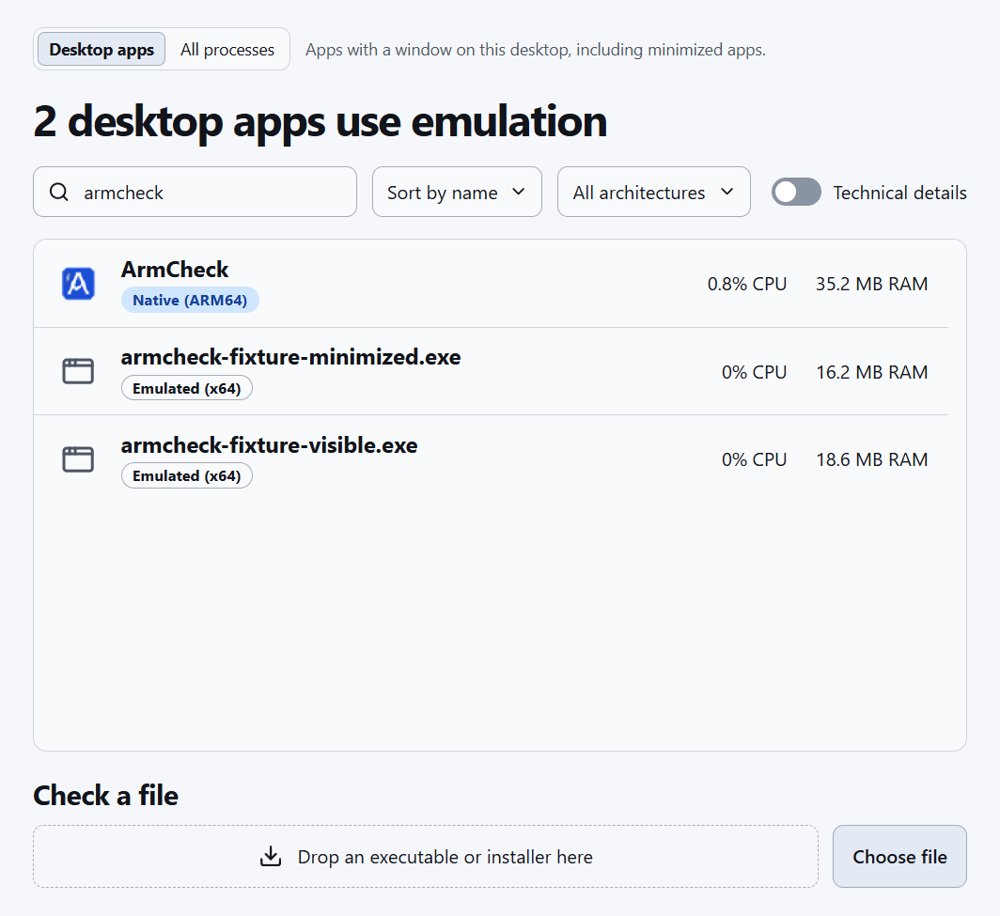

# ArmCheck


ArmCheck shows which apps on your Windows 11 on ARM PC are running natively and which are using emulation. It also checks the architecture recorded in an executable or installer.

[Project website](https://armcheck.vercel.app) · [Download the Windows ARM64 installer](https://github.com/Reyansh-Varshney/ArmCheck/releases/latest)

<details>
<summary>Desktop preview</summary>



The preview shows a local smoke test with two controlled x64 applications.

</details>

## Install and run

Download the `ArmCheck_*_arm64-setup.exe` asset from Releases and open it on a Windows 11 ARM64 device. The installed app runs natively and uses the Microsoft Edge WebView2 Runtime.

The initial release is unsigned, so Windows may display a publisher or reputation warning. The release includes SHA-256 checksums. To verify a download, compare the digest produced by this command with its matching entry in the release checksum file.

```powershell
Get-FileHash -Algorithm SHA256 -Path .\ArmCheck_*_arm64-setup.exe
```

## What ArmCheck shows

- **Desktop apps** starts with apps that have recognizable windows on the current desktop. **All processes** includes background and system processes.
- Search and sort the list, or filter by architecture or verification reason. **Technical details** shows the Windows results and PE evidence behind a label.
- **Check a file** accepts an executable or installer from the file picker or by drag and drop. An installer's machine type can differ from the app it installs.
- CPU and working-set RAM are sampled while the window is visible. Minimizing or closing to the notification area pauses new scans. Use the tray menu to show or quit the app.

ArmCheck reads process and file information locally. Its labels cover the running process or the selected file. CPU and RAM measurements describe activity and memory use.

### Why an app can be unverified

Windows restricts queries for some processes. Hybrid ARM executables and conflicting or incomplete results also require extra care. ArmCheck explains why a label is unverified and keeps the underlying process available in **All processes**. Where a readable executable has a conclusive machine type, its file architecture can be shown separately from the running process result. [How classification works](ARCHITECTURE.md#file-and-process-results)

## Build from source

Develop on Windows 11 ARM64 with the WebView2 Runtime, Visual Studio C++ ARM64 Build Tools and Windows SDK, Rust 1.98 or newer with rustfmt and Clippy, and Node.js 24 or newer with npm. The workflow checks the project with Rust 1.98.0 and Node.js 24.

From the repository root in PowerShell:

```powershell
npm --prefix app ci
Set-Location app
npm run tauri -- dev
```

To build the release and Windows installer, run this from `app`:

```powershell
npm run tauri -- build --ci --target aarch64-pc-windows-msvc -- --locked
```

The app is written to `target/aarch64-pc-windows-msvc/release/armcheck.exe` under the repository root. The installer is under `target/aarch64-pc-windows-msvc/release/bundle/nsis/`. Add `--no-bundle` before the second `--` to build the app without an installer.

## CLI and project layout

From the repository root:

```powershell
cargo run --locked -p armcheck-cli -- scan
cargo run --locked -p armcheck-cli -- scan --json
cargo run --locked -p armcheck-cli -- check "C:\path\to\app.exe"
```

| Directory | Contents |
| --- | --- |
| [core](core) | Windows process scanner, PE file inspector, and shared data model |
| [cli](cli) | Terminal interface for the same Rust core |
| [app](app) | React, TypeScript, and Tauri desktop interface |
| [site](site) | Public project website deployed to Vercel |

See [the architecture notes](ARCHITECTURE.md), [the changelog](CHANGELOG.md), and [the contributor guide](CONTRIBUTING.md). ArmCheck is available under the [MIT license](LICENSE).
